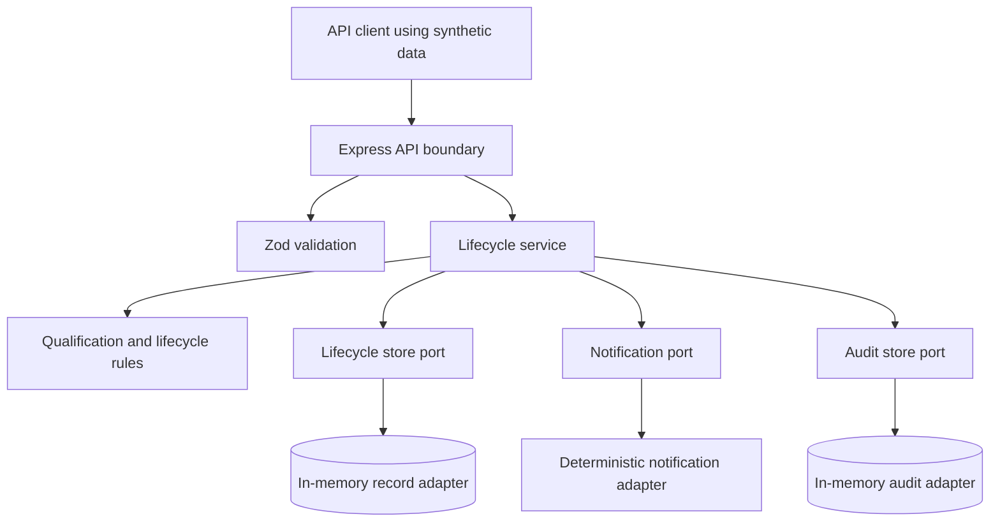
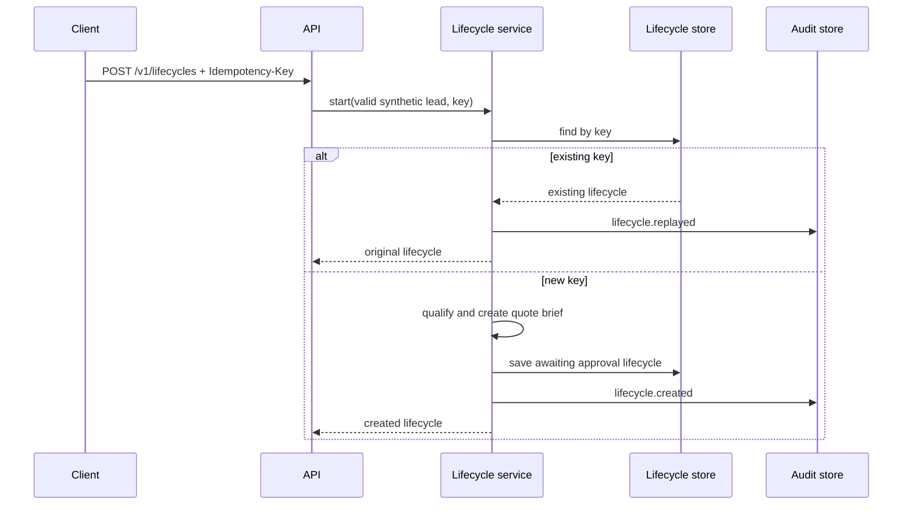
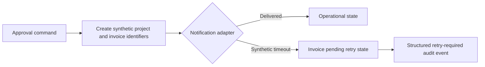

# Architecture

## Component responsibilities

The API layer is responsible for parsing requests and translating known errors into HTTP responses. The application service owns lifecycle orchestration. The domain layer owns deterministic qualification rules and valid lifecycle states. Ports prevent the domain/application layers from depending on an actual CRM, messaging service, support platform, database, or LLM provider.

## Lifecycle sequence

## Failure and retry boundary

The sample does not run a queue or automated retry worker. It intentionally models the state and audit boundary where a production system would use durable storage, retry scheduling, idempotent external calls, and monitoring.

## System boundaries

| Inside this repository                                                                                    | Explicitly outside this repository                                                                                                                                    |
| --------------------------------------------------------------------------------------------------------- | --------------------------------------------------------------------------------------------------------------------------------------------------------------------- |
| Synthetic lead data, deterministic scoring, in-memory records, API responses, audit metadata, tests, docs | Real CRM credentials, customer records, payments, emails, webhooks, queues, production persistence, LLM calls, user authentication, deployment secrets, customer SLAs |
